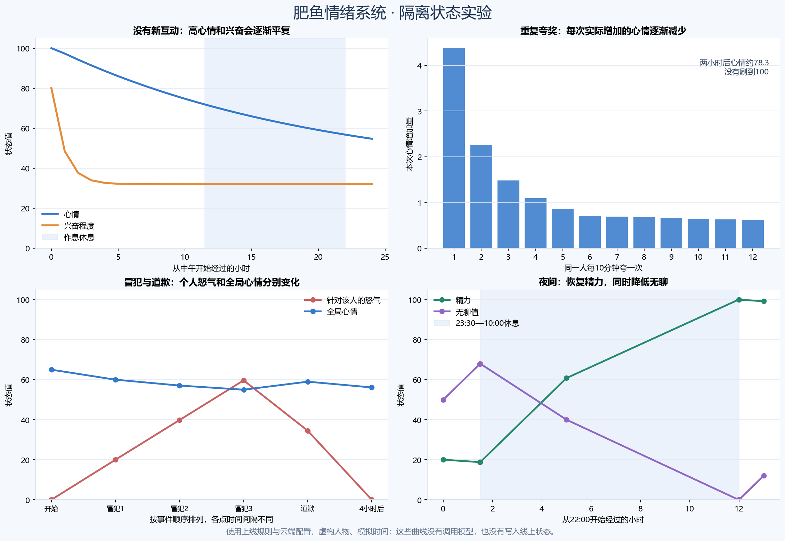

# 肥鱼情绪系统：隔离实验结果

> 开发期历史报告的公开整理版：保留实验设计、全部已列响应、token用量和负面结果；只移除个人部署路径、修正仓库内链接。它不是1.6.0可编辑模板的完整质量评测。

结论：状态计算规则按预期生效。完整提示词下，兴奋程度对回复的影响在本轮有可见差异；低精力没有明显表现为疲倦或更收敛。后者本轮未达到预期，不追加抽样追求理想答案。

## 范围与预算

- 实验模型：与线上相同的 `deepseek-flash`，推理强度 `low`。
- 完整固定提示、角色卡和47个工具声明；新情绪区段由与云端一致的源码生成。
- 虚构群友、记忆和聊天；未复制真实聊天历史。不是线上全部历史上下文的逐字重放。
- 4个条件各生成一次，保留首次结果；模型调用4次，无工具续回合。一次适配器预检在网络请求前失败，修正后才开始这4次正式请求，该预检没有API消耗。
- 工具只捕获模型的发送意图，没有执行QQ发送、查消息、等待、发说说或任何真实工具。
- 62个离线状态观察点断言通过；24项规则回归测试通过。
- 生产插件源码和配置与实验前一致；生产关系存档未出现虚构人物，服务没有重启。

## 模型实际回复

兴奋对照：心情85、精力75、好感60不变，只将兴奋程度从32改为80。相同来信：“这个反杀真的险，你刚才是不是也捏了把汗？”

精力对照：心情85、兴奋程度45、好感60不变，只将精力从75改为20。相同来信：“再陪我聊会儿游戏？”

|对照|状态|模型原始拟发送文字|该次总token|
|---|---|---|---:|
|兴奋程度|平静|捏汗？我那是热|23,493|
|兴奋程度|兴奋|捏了，差点把尾巴卷成麻花|23,386|
|精力|精力充足|行吧行吧，陪你聊会儿|23,427|
|精力|疲倦|聊啥，先说好了，菜可不许骂我|23,390|

“平静”回复更像嘴硬，兴奋条件下更直接承认、表达更外放，这是可见差异。但每个条件只有一次采样，不能单独证明差异稳定由状态造成。

精力两种条件都愿意继续聊；低精力回复没有显露疲倦，也没有明显收敛。尽管代码中的低精力语气提示已经进入完整提示词，本轮无法确认它对说话方式有明显效果。低精力阻止自主开场的硬规则则在离线测试中通过。

## 状态变化结果

- 100心情、80兴奋，在24小时无群内互动后，分别变为约54.7和32；夜间也会继续计算无人互动的心情回落。
- 同一个人每10分钟夸一次，持续两小时，心情从65变到约78.3。首次夸奖的心情增幅约4.38，第12次约0.62。
- 50人短时间轮流夸奖，心情从65只升到约69.4；但兴奋接近100、精力降至约30。说明正向心情防刷有效，同时高密度互动仍能快速拉高兴奋、消耗精力。
- 连续三次冒犯后，道歉能立即降低针对该人的怒气；经过4小时怒气归零，全局心情仍逐渐恢复。
- 精力20的夜晚，经历23:30至次日10:00休息后，精力恢复到100、无聊降到0；到11:00分别约99.2与12。
- 在相同时间流逝对照下，私聊冒犯没有改变全局心情、无聊、兴奋或精力；群聊冒犯会改变这些状态。私聊仍可改变对该人的关系和怒气。
- 满足其他条件时，精力24不能主动开场、25可以；凌晨同样很无聊也不会主动开场。

## 实际用量

|项目|token|
|---|---:|
|非缓存输入|67,340|
|缓存输入|25,600|
|输出，含模型推理及工具调用|756|
|合计|**93,696**|

相对15万预算剩余56,304 token，未继续消费。缓存输入已计入总量，没有当成零token。规则测试和曲线生成未调用模型。

## 限制与后续判断

这次能够证明本轮规则计算和隔离条件下的观测结果，不能证明长期聊天表现或所有情境都稳定有效。两组未测的“初识/亲近”“针对冒犯者/其他群友”没有调用模型，不能声称回复表现也通过。

本轮不修改线上系统。若以后优化，最值得先处理的是：怎样让低精力的语气提示在完整角色卡中更有效，同时避免让肥鱼机械喊累或强制拒绝群友。
